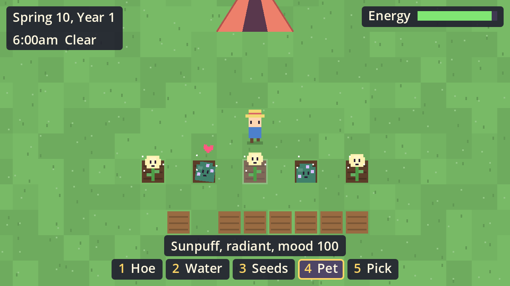
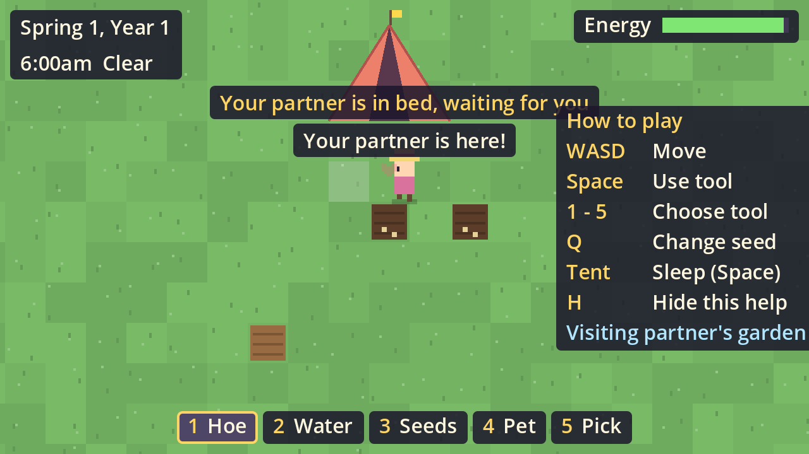

# Bloom-In-Progress
Grow a Garden Multiplayer Video Game for Couples

A cozy pixel-art co-op gardening game made with Godot 4. You can tend the
garden alone or host it for a partner to join online. Art is placeholder for now.




## Run it
1. Install [Godot 4.4 or newer](https://godotengine.org/download) (standard version).
2. Open Godot, choose **Import**, pick this folder's `project.godot`, then press **F5**.

Or from a terminal in this folder:

```bash
godot --path .
```

## Controls
| Key | Action |
|---|---|
| WASD / arrows | Move |
| Space / E | Use the current tool on the highlighted tile |
| 1-5 | Hoe, Watering Can, Seeds, Hands (pet), Basket (harvest) |
| Tab | Next tool |
| Q | Next seed type |
| H | Show or hide the help card |

Face the tent and press Space to sleep. Plants grow overnight if they were
watered, and the game saves each night.

## Playing together
One of you hosts; the garden and its save file live on the host's computer.

1. **Host:** choose "Host my garden for a partner". The help card shows the
   address to share.
2. **Partner:** type that address into the box on the start screen and press Join.

- On the same Wi-Fi this works as is (allow Godot/the game through the
  firewall if Windows asks).
- Over the internet, either the host forwards **UDP port 24565** on their
  router and shares their public address, or you both install a free tool
  such as Tailscale and use the address it gives the host.
- The day ends when you are both in the tent. Petting the same plant on the
  same day gives it a duet mood bonus.

To try co-op on one computer, start two copies and join `127.0.0.1`:

```bash
godot --path . -- --host
```

```bash
godot --path . -- --join=127.0.0.1
```

## Tests
Garden rules:

```bash
godot --headless --path . res://tests/test_runner.tscn
```

Co-op (starts a host and a guest on this machine; needs bash):

```bash
tests/run_coop_test.sh godot
```

See `docs/DESIGN.md` for the rules and roadmap.
