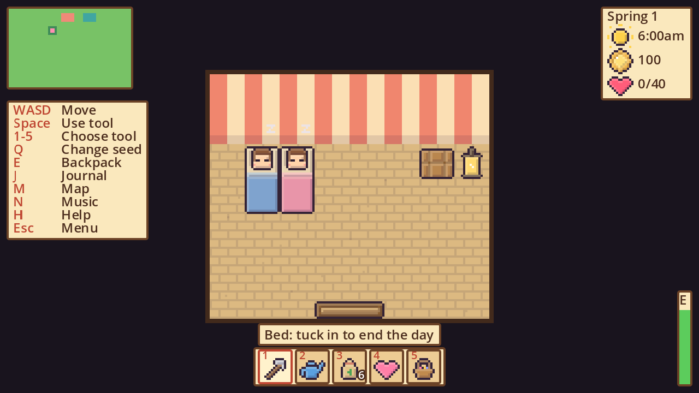
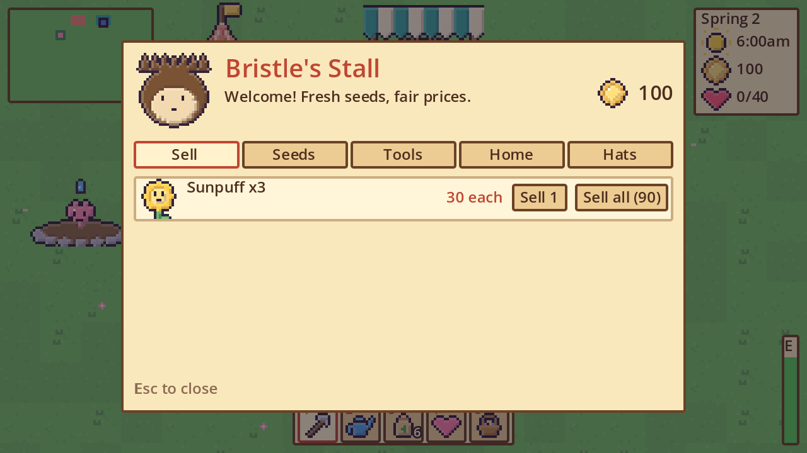

# Bloom-In-Progress
Grow a Garden Multiplayer Video Game

A cozy pixel-art co-op gardening game made with Godot 4. You can tend the
garden alone or host it for a partner to join online.






## Download and play
- **[Download for Windows](https://github.com/chowmein3/Bloom-In-Progress/raw/downloads/BloomInProgress-windows.zip)**
- **[Download for Mac](https://github.com/chowmein3/Bloom-In-Progress/raw/downloads/BloomInProgress-macos.zip)** (Intel and Apple Silicon)
- [Download for Linux](https://github.com/chowmein3/Bloom-In-Progress/raw/downloads/BloomInProgress-linux.zip)

Unzip it and open the game. Nothing else to install. The game isn't signed
with a paid developer certificate, so the first launch needs one extra step:

- **Windows:** double-click **BloomInProgress.exe**. If Windows says it
  doesn't recognise the app, click **More info**, then **Run anyway**.
- **Mac:** right-click (or Control-click) **Bloom In Progress** and choose
  **Open**, then **Open** again. On newer macOS, if there is no Open button,
  go to **System Settings > Privacy & Security**, scroll down and click
  **Open Anyway**. If macOS says the app is damaged, run this in Terminal,
  with the app's real location, and open it again:

  ```bash
  xattr -cr "/Applications/Bloom In Progress.app"
  ```

Windows and Mac players can play together; see
[Playing together](#playing-together). The downloads are rebuilt every time
`main` changes.

## Run it from source
1. Install [Godot 4.4 or newer](https://godotengine.org/download). Get the
   **standard** build, not the ".NET" one: the .NET build asks for a .NET SDK
   this game doesn't use.
2. Open Godot, choose **Import**, pick this folder's `project.godot`, then press **F5**.

Or from a terminal in this folder (the first command is only needed once after
downloading, and again whenever art or audio files change):

```bash
godot --headless --path . --import
```

```bash
godot --path .
```

## Controls
| Key | Action |
|---|---|
| WASD / arrows | Move |
| Shift (hold) | Run |
| Space / left click | Use the held tool on the tile ahead. If the tool has nothing to do there, your hand acts instead |
| F / right click | Use your hand: pet, pick, pick up, clear, hug the tree, open doors and stalls |
| Aiming | Space and F work on the tile in front of you. A click works on the tile under the cursor if it's one of the 8 round you (diagonals too), turning you to face it; click farther away and it works on the tile in front. The highlighted tile shows which |
| 1-7 | Hoe, Watering Can, Seeds, Item (place or eat), Fishing Rod, Pickaxe once bought, and Axe. Clicking a slot works too |
| T | Emotes (then 1-6) |
| Enter | Chat with your partner (co-op) |
| Tab | Next tool |
| Q | Next seed type, or next item when the item slot is selected |
| E / I | Backpack: seeds, harvest, coins, hats |
| 8 9 0 - | Hot bar (drag things onto it in the backpack) |
| J | Garden journal |
| M | Show or hide the minimap |
| N | Music on/off |
| H | Show or hide the help card |
| Esc | Pause menu (resume, return to title, exit) |

Face your home's door and press F to go inside, then face the bed and press F
to tuck in. Walk down off the door mat to go back out. Plants grow overnight if they were watered, and the game saves each
night.

## Settings and saving
The title and pause menus have **Settings**: music and sound volume,
fullscreen, and the key list. The pause menu (Esc) also has **Save now**, on
top of the automatic save each night. Only the host's game saves.

## Title menu
- **New:** name a garden and start it. Each garden has its own save file.
- **Load:** pick a saved garden, or delete one.
- **Co-op:** host one of your gardens for a partner, or join theirs.
- **Exit:** quit.

Gardens are saved each night when you sleep, and whenever you choose Save now
in the pause menu.

## What to do
- Water plants every day; pet them (tool 4) to raise their mood. A happy plant
  in bloom turns radiant and gives extra seeds.
- Care for the **Heart Tree** by the tent: water and hug it daily. It also
  grows from all the care the rest of the garden gets, and drops seeds for new
  kinds of plants each time it reaches a new stage.
- The **journal** (J) fills in as you plant, bloom and make radiant each of
  the eight kinds of plant.
- Plants sleep through seasons they don't like; they don't die.
- **Home:** the tent has a room inside with a bed for two. Once everyone is
  in bed you see them tucked in together, breathing softly, while the screen
  fades slowly to black, then the next day begins. Every night (for now), he sits
  up, turns to her and leans over for a goodnight kiss, with a little heart. Getting
  up during the fade (Space) calls it off.
- **Bristle's stall** (the hedgehog beside your home): sell your harvest and
  anything else for coins. Seeds and the rest are at his store in town.
- **The town:** walk up the trail at the top of the garden to reach it (and
  down the trail at its bottom to come home). A river runs through it from a
  waterfall, under two bridges; a cobbled plaza with a fountain sits below the
  town hall, and stairs climb a cliff to the museum, the apothecary and a
  lookout. Every building can be walked into: press F at its door while
  it's open (the cursor on a building shows its hours), and walk down off
  the mat to leave. Shopkeepers stand behind their counters; face one and
  press F to talk, buy, sell, take on their request or give a gift. Outside
  shop hours everyone keeps their own routine: a morning walk, an evening
  at the inn or by the fountain, home to bed, and a day off each week. You
  can still chat with them wherever they are, and on rainy days they shelter
  at the inn. The
  museum shows every donation in a case, and Maple, Pebble and Thistle
  welcome visitors at home from 8am to 9pm:
  - **Bristle** (General Store): seeds, animals and feed, pantry, decor, hats.
  - **Juniper** the baker: flour, sugar, butter, cinnamon, buns and the oven;
    pays extra for wheat, fruit, eggs, milk, honey and baking.
  - **Flint** the blacksmith (forge): hoe, watering can and pickaxe upgrades,
    copper and gold; pays extra for ore and gems.
  - **Marlow** the fishmonger (fish shack on the river): pays extra for fish.
  - **Birch** the carpenter: the cabin and cottage, greenhouse, coop and barn,
    wood, stone and furniture; pays extra for wood, stone and fiber.
  - **Sage** the herbalist (apothecary): energy tonics and mulch; pays extra
    for forage and flowers.
  - **Professor Quill** (museum): donate one of each fish, ore, gem and
    forage; thank-you gifts at 3, 6, 9, 13 and all 17.
  - **Mayor Clementine** (town hall): the notice board's requests.
  - **Rosie** (The Snug Mug inn, noon to midnight): hot meals; pays extra for
    cooking, cheese, jam and juice.
  Each of them asks for something now and then (their Request tab) and pays
  well for it; chats, gifts and requests earn hearts and presents, as with
  the visitors. Maple, Pebble and Old Thistle live in town too, when they
  aren't visiting your garden.
- **In town:** fish the river (its own fish: trout, pike, eels after dark,
  salmon in spring and fall), toss a coin in the fountain for luck (rare fish
  bite more often that day), take in the view at the lookout once a day for
  a little energy, pick fruit in the town orchard, and forage on the flower
  meadow and up on the cliff.
- **Hands:** no tool is needed to pet, pick or pick things up. Face it and
  press F. A plant you haven't petted today gets petted; a ripe plant you
  already petted gets picked. The line above the tool bar shows what F will do.
- **Artisan machines** (Crafting tab): a preserves jar (2 of any harvest make
  jam in two days), a juice press (2 plumbles), a cheese press (milk, one day)
  and a beehive (honey every three days, no filling). Set one down, press F to
  fill it, and F again to collect when the green mark shows.
- **Mailbox** (left of your home): letters arrive some mornings, a few with
  gifts. A mark bobs above it when there's post.
- **Notice board** (right of your home): three requests at a time from the
  villagers and townsfolk (the town hall has the same board). Handing one in pays coins and pleases whoever asked.
- **Greenhouse** (built by Birch, in town): a glass house in the lower right where
  any plant can be planted and grows in every season.
- **More plants:** sixteen kinds now. Bristle's store stocks eight new ones as your
  gardening level reaches 2 and 4.
- **Foraging and storms:** a wild plant of the season turns up most mornings
  to pick by hand, and some rainy days are storms that blow in extra debris.
- **With a partner:** set your name in Settings; it shows above your head with
  the tool you're holding. T opens emotes, Enter opens a chat line, and you
  see each other use tools.
- **Animals:** have Birch build a coop, then a barn, and buy hens and cows
  at Bristle's store. Each morning feed them (F, with animal feed in the backpack)
  and stroke them (F again). Fed animals give eggs and milk overnight; happy
  ones give two.
- **Visitors:** Maple, Pebble and Old Thistle each drop by two days a week and
  stand near the stall (the rest of the time they're at home in town). Talk (F) once a day and give one gift a day; each has
  loves, likes and dislikes. Every new heart of friendship brings a present.
- **The mine:** the cave mouth at the top right leads to a room of rocks,
  renewed every morning. Buy the pickaxe from Flint at the forge in town (its slot
  appears on the tool bar once you own it), face the cave mouth and press F to
  go down, then break rocks (6, Space)
  for stone, copper, gold and the odd amethyst. Copper and gold make the Great
  Sprinkler, which waters all eight tiles around it.
- **Quality:** a happy plant gives silver-quality harvest and a radiant one
  gold, worth a quarter and a half more.
- **Crows and scarecrows:** with six or more plants, a crow sometimes pecks one
  overnight and it loses mood. A scarecrow (wood and fiber) guards six tiles
  around it.
- **Fruit trees:** buy a plumble sapling (Decor tab), set it on open ground,
  and after ten days it bears a plumble every three days, except in winter.
- **Fishing:** face the pond (or the town's river) with the rod (5) and press Space. Wait for the
  "!", press Space to hook it, then press Space each time the marker crosses
  the green band. Which fish bite depends on season, hour and rain. Sell them,
  ship them or cook them.
- **Shipping bin** (the crate between your home and the stall): drop harvest
  and fish in; they're sold overnight at Bristle's prices.
- **Decor:** buy furniture from Birch the carpenter (and garden decor from Bristle), hold it (4) and set it
  down inside your home or in the garden.
- **Goals** (journal, Goals page): eleven long-term goals that pay coins when
  met, and a special hat for finishing them all.
- **Festivals:** day 14 of each season, with a party in the town plaza from
  5pm to 10pm. The whole town comes, and Mayor Clementine by the fountain runs
  the fun. Bloom Show: enter your finest harvest (radiant plants win coins
  too). Firefly Night: catch five fireflies for a jar (petting counts double).
  Harvest Fair: fill the town's display (everything sells for half as much
  again). Lantern Night: send up three sky lanterns for a gift.
- **Gathering:** branches, rocks and weeds turn up around the garden. Clear
  them by hand (F) for wood, stone and fiber.
- **Crafting** (backpack, Crafting tab): stepping stones, fences, rich mulch
  (plants in it often grow twice as fast), sprinklers (water the four tiles
  beside them every morning) and garden lanterns. Click a made thing in the
  backpack to hold it, then press 4 and Space to set it down; F picks it
  back up.
- **Cooking** (backpack, Kitchen tab, needs the Cabin's stove): turn harvest
  into meals. Hold a meal and press Space to eat it for energy.
- **Baking** (backpack, Oven tab): buy an oven from Juniper the baker and
  set it down in your home; F at the oven opens the tab. Banana bread, apple
  pie and cinnamon buns restore lots of energy and sell well. Grow the core
  parts: wheat (milled into flour on the Kitchen tab) and apple and banana
  trees (saplings at Bristle's store). Sugar, butter, cinnamon, eggs and spare
  flour come from Juniper or Bristle's Pantry tab, or as gifts from visitors.
- **Axe** (7): trees, stumps and logs in the garden come down after a few
  swings (three for a tree), and the tree topples over and leaves a stack of
  wood on the ground; walk over it to pick it up. They grow back after a
  season unless something is built or dug where they stood. The woods round
  the edge of the garden can't be cut.
- **Gardening level:** caring for plants and harvesting earn experience.
  Levels unlock recipes and add a little energy.
- **Bristle's requests:** each morning he asks for a plant you can grow and
  pays double for it (Sell tab at the stall or his store).
- **Clock tower** (left of your home): face it and press Space to set any
  season, day, year, time of day and weather, to see how the garden looks
  then. Nothing grows or wilts for the time skipped. Expect a scene.
- **Backpack** (E): your own seeds, harvest and things, your coins, and the
  hats. Click a seed packet to hold it; click a hat to wear it. Drag a stack
  to move it to another slot, or onto the hot bar row: those four slots show
  on the tool bar and keys 8, 9, 0 and - take them in hand. Drag a stack out
  of the backpack to drop it on the ground in front of you; walk over it (or
  press F at it) to pick it up. That's also how to give things to your partner.
- Each player has their own coins, seeds, harvest, things and part of the
  shipping bin, which pays them overnight. Prizes from festivals, goals and
  the Heart Tree go to everyone. Tool and home upgrades, animals, the hat
  wardrobe and the garden itself are shared.

## Playing together
One of you hosts; the garden and its save file live on the host's computer.
You each need the game.

### Through the relay (no router settings, no addresses)
1. **Host:** title menu > **Co-op > Host** > pick a garden. The game shows the
   garden's invite code (like `ABC-DEF`) and copies it; send it to your partner.
2. **Partner, first time:** **Co-op > Join**, paste the code, press Join.
3. **Every time after:** the partner's Join screen lists the garden and lights
   it up whenever the host has it open. One click.

The game is set up to use the relay at
`https://bloom-in-progress-relay.onrender.com`. The first connection of the
day can take up to a minute while the relay wakes. See
[Setting up the relay](#setting-up-the-relay) to run your own.

### Without the relay (`relay_url=""` in `project.godot`)
- **Same Wi-Fi:** the host's garden appears on the partner's Join screen by
  itself; click it. If Windows asks about the firewall, click **Allow access**.
- **Different homes:** the host's game asks their router to let the partner in
  (UPnP). When that works, the host's help card (H) shows an "Elsewhere:"
  address for the partner to type. Otherwise the host forwards **UDP port
  24565** on their router.

In both cases the day ends when you are both in the tent, and petting the same
plant on the same day gives it a duet mood bonus.

## Setting up the relay
The relay is a tiny server (`relay/server.js`) that both games connect out to,
so neither player opens a router port. It only passes messages between the two
of you and stores nothing. Deploying it on Render's free plan takes a few minutes:

1. Open <https://render.com/deploy?repo=https://github.com/chowmein3/Bloom-In-Progress>
   and sign in with GitHub.
2. Accept the suggested service (`bloom-in-progress-relay`, free plan) and
   press **Deploy**. Wait until it says **Live**.
3. Copy the service's address from the top of its page. It looks like
   `https://bloom-in-progress-relay.onrender.com`. Opening it in a browser
   should show "Bloom In Progress relay is running".
4. Put that address in `project.godot`, in the `[bloom]` section:
   `relay_url="https://bloom-in-progress-relay.onrender.com"`, then rebuild
   the download (or run from source). Both players need a build with it.

   To try it without rebuilding, put a text file named `override.cfg` next to
   `BloomInProgress.exe` on both computers, containing:

   ```
   [bloom]
   relay_url="https://bloom-in-progress-relay.onrender.com"
   ```

A free Render service goes to sleep after 15 minutes without visitors, so the
first connection of the day can take up to a minute while it wakes. The game
starts waking it as soon as it launches.

To try co-op on one computer, start two copies and join `127.0.0.1`:

```bash
godot --path . -- --host
```

```bash
godot --path . -- --join=127.0.0.1
```

## Building the download yourself
With Godot's export templates installed (Editor > Manage Export Templates):

```bash
tools/build.sh godot
```

This writes `export/BloomInProgress-windows.zip`, `-macos.zip` and `-linux.zip`.
`tools/publish_downloads.sh` then puts them on the `downloads` branch, which is
where the links above point. `.github/workflows/release.yml` does both on every
push to `main` when GitHub Actions is available for the account.

## Art and audio
The sprites and sounds are generated by two scripts, so there is nothing to
license:

```bash
python3 tools/make_art.py
```

```bash
python3 tools/make_audio.py
```

To use hand-drawn art or your own music, replace any file in `assets/` with one
of the same name, size and frame layout (described at the top of each section
of the scripts) and stop running the script for that file.

## Tests
Garden rules:

```bash
godot --headless --path . res://tests/test_runner.tscn
```

Menus (title, new, load, host, join, pause):

```bash
godot --headless --path . res://tests/menu_test.tscn
```

Home, bed, shop and backpack, played with key presses:

```bash
godot --headless --path . res://tests/home_test.tscn
```

Co-op (starts a host and a guest on this machine; needs bash):

```bash
tests/run_coop_test.sh godot
```

See `docs/DESIGN.md` for the rules and roadmap.
