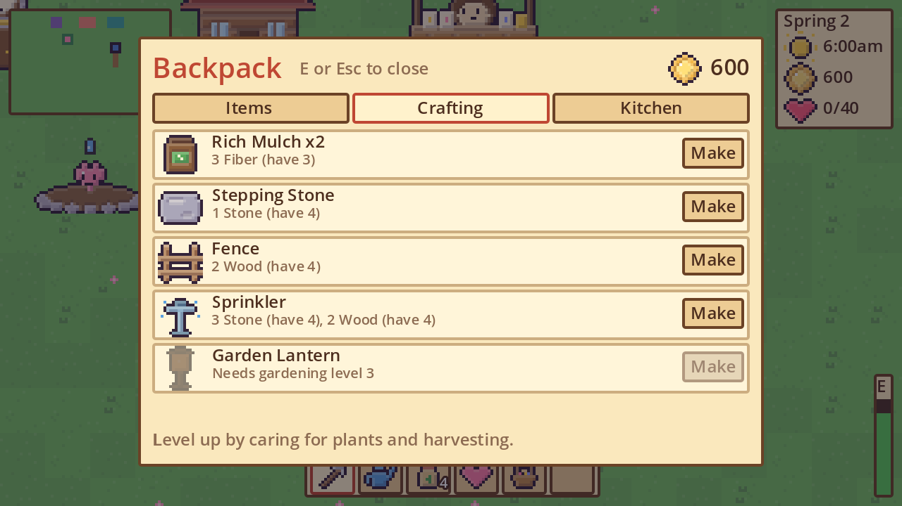
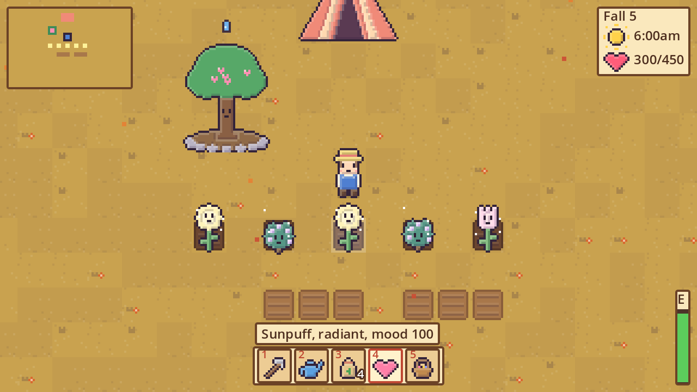

# Bloom-In-Progress
Grow a Garden Multiplayer Video Game

A cozy pixel-art co-op gardening game made with Godot 4. You can tend the
garden alone or host it for a partner to join online.






## Download and play
- **[Download for Windows](https://github.com/chowmein3/Bloom-In-Progress/raw/downloads/BloomInProgress-windows.zip)**
- **[Download for Mac](https://github.com/chowmein3/Bloom-In-Progress/raw/downloads/BloomInProgress-macos.zip)** (Intel and Apple Silicon)
- [Download for Linux](https://github.com/chowmein3/Bloom-In-Progress/raw/downloads/BloomInProgress-linux.zip)

Unzip it and open the game. Nothing else to install. The game isn't signed
with a paid developer certificate, so the first launch needs one extra step:

- **Windows:** double-click **BloomInProgress.exe**. If Windows says it
  doesn't recognise the app, click **More info**, then **Run anyway**.
- **Mac:** right-click (or Control-click) **Bloom In Progress** and choose
  **Open**, then **Open** again. On newer macOS, if there is no Open button,
  go to **System Settings > Privacy & Security**, scroll down and click
  **Open Anyway**. If macOS says the app is damaged, run this in Terminal,
  with the app's real location, and open it again:

  ```bash
  xattr -cr "/Applications/Bloom In Progress.app"
  ```

Windows and Mac players can play together; see
[Playing together](#playing-together). The downloads are rebuilt every time
`main` changes.

## Run it from source
1. Install [Godot 4.4 or newer](https://godotengine.org/download). Get the
   **standard** build, not the ".NET" one: the .NET build asks for a .NET SDK
   this game doesn't use.
2. Open Godot, choose **Import**, pick this folder's `project.godot`, then press **F5**.

Or from a terminal in this folder (the first command is only needed once after
downloading, and again whenever art or audio files change):

```bash
godot --headless --path . --import
```

```bash
godot --path .
```

## Controls
| Key | Action |
|---|---|
| WASD / arrows | Move |
| Shift (hold) | Run |
| Space / left click | Use the held tool on the tile ahead. If the tool has nothing to do there, your hand acts instead |
| F / right click | Use your hand: pet, pick, pick up, clear, hug the tree, open doors and stalls |
| 1-6 | Hoe, Watering Can, Seeds, Item (place or eat), Fishing Rod, Pickaxe. Clicking a slot works too |
| Tab | Next tool |
| Q | Next seed type, or next item when the item slot is selected |
| E / I | Backpack: seeds, harvest, coins, hats |
| J | Garden journal |
| M | Show or hide the minimap |
| N | Music on/off |
| H | Show or hide the help card |
| Esc | Pause menu (resume, return to title, exit) |

Face your home's door and press F to go inside, then face the bed and press F
to tuck in. Walk down off the door mat to go back out. Plants grow overnight if they were watered, and the game saves each
night.

## Settings and saving
The title and pause menus have **Settings**: music and sound volume,
fullscreen, and the key list. The pause menu (Esc) also has **Save now**, on
top of the automatic save each night. Only the host's game saves.

## Title menu
- **New:** name a garden and start it. Each garden has its own save file.
- **Load:** pick a saved garden, or delete one.
- **Co-op:** host one of your gardens for a partner, or join theirs.
- **Exit:** quit.

Gardens are saved each night when you sleep, and whenever you choose Save now
in the pause menu.

## What to do
- Water plants every day; pet them (tool 4) to raise their mood. A happy plant
  in bloom turns radiant and gives extra seeds.
- Care for the **Heart Tree** by the tent: water and hug it daily. It also
  grows from all the care the rest of the garden gets, and drops seeds for new
  kinds of plants each time it reaches a new stage.
- The **journal** (J) fills in as you plant, bloom and make radiant each of
  the eight kinds of plant.
- Plants sleep through seasons they don't like; they don't die.
- **Home:** the tent has a room inside with a bed for two. The day ends when
  everyone is in bed; in co-op you can see each other tucked in.
- **Bristle's stall** (the hedgehog beside your home): sell picked plants for
  coins, and buy seeds, a hoe and watering can that reach 3 then 5 tiles, a
  cabin and then a cottage (more room, more energy each morning), and hats.
- **Hands:** no tool is needed to pet, pick or pick things up. Face it and
  press F. A plant you haven't petted today gets petted; a ripe plant you
  already petted gets picked. The line above the tool bar shows what F will do.
- **Animals:** build a coop, then a barn, at Bristle's Animals tab and buy
  hens and cows. Each morning feed them (F, with animal feed in the backpack)
  and stroke them (F again). Fed animals give eggs and milk overnight; happy
  ones give two.
- **Visitors:** Maple, Pebble and Old Thistle each drop by two days a week and
  stand near the stall. Talk (F) once a day and give one gift a day; each has
  loves, likes and dislikes. Every new heart of friendship brings a present.
- **The mine:** the cave mouth at the top right leads to a room of rocks,
  renewed every morning. Face the cave mouth and press F to go down, then break
  rocks with the pickaxe you start with (6, Space)
  for stone, copper, gold and the odd amethyst. Copper and gold make the Great
  Sprinkler, which waters all eight tiles around it.
- **Quality:** a happy plant gives silver-quality harvest and a radiant one
  gold, worth a quarter and a half more.
- **Crows and scarecrows:** with six or more plants, a crow sometimes pecks one
  overnight and it loses mood. A scarecrow (wood and fiber) guards six tiles
  around it.
- **Fruit trees:** buy a plumble sapling (Decor tab), set it on open ground,
  and after ten days it bears a plumble every three days, except in winter.
- **Fishing:** face the pond with the rod (5) and press Space. Wait for the
  "!", press Space to hook it, then press Space each time the marker crosses
  the green band. Which fish bite depends on season, hour and rain. Sell them,
  ship them or cook them.
- **Shipping bin** (the crate between your home and the stall): drop harvest
  and fish in; they're sold overnight at Bristle's prices.
- **Decor:** buy furniture from Bristle's Decor tab, hold it (4) and set it
  down inside your home or in the garden.
- **Goals** (journal, Goals page): eleven long-term goals that pay coins when
  met, and a special hat for finishing them all.
- **Festivals:** day 14 of each season. Bloom Show (radiant plants win coins),
  Firefly Night (petting counts double), Harvest Fair (everything sells for
  half as much again), Lantern Night (three lanterns bring a gift).
- **Gathering:** branches, rocks and weeds turn up around the garden. Clear
  them by hand (F) for wood, stone and fiber.
- **Crafting** (backpack, Crafting tab): stepping stones, fences, rich mulch
  (plants in it often grow twice as fast), sprinklers (water the four tiles
  beside them every morning) and garden lanterns. Click a made thing in the
  backpack to hold it, then press 4 and Space to set it down; F picks it
  back up.
- **Cooking** (backpack, Kitchen tab, needs the Cabin's stove): turn harvest
  into meals. Hold a meal and press Space to eat it for energy.
- **Gardening level:** caring for plants and harvesting earn experience.
  Levels unlock recipes and add a little energy.
- **Bristle's requests:** each morning he asks for a plant you can grow and
  pays double for it (Sell tab at the stall).
- **Clock tower** (left of your home): face it and press Space to set any
  season, day, year, time of day and weather, to see how the garden looks
  then. Nothing grows or wilts for the time skipped. Expect a scene.
- **Backpack** (E): the garden's shared seeds and harvest, your coins, and the
  hats you own. Click a seed packet to hold it; click a hat to wear it.
- Coins, seeds, harvest, tools, the home and the hat wardrobe are shared by
  both players. Each player picks their own hat to wear.

## Playing together
One of you hosts; the garden and its save file live on the host's computer.
You each need the game.

### Through the relay (no router settings, no addresses)
1. **Host:** title menu > **Co-op > Host** > pick a garden. The game shows the
   garden's invite code (like `ABC-DEF`) and copies it; send it to your partner.
2. **Partner, first time:** **Co-op > Join**, paste the code, press Join.
3. **Every time after:** the partner's Join screen lists the garden and lights
   it up whenever the host has it open. One click.

The game is set up to use the relay at
`https://bloom-in-progress-relay.onrender.com`. The first connection of the
day can take up to a minute while the relay wakes. See
[Setting up the relay](#setting-up-the-relay) to run your own.

### Without the relay (`relay_url=""` in `project.godot`)
- **Same Wi-Fi:** the host's garden appears on the partner's Join screen by
  itself; click it. If Windows asks about the firewall, click **Allow access**.
- **Different homes:** the host's game asks their router to let the partner in
  (UPnP). When that works, the host's help card (H) shows an "Elsewhere:"
  address for the partner to type. Otherwise the host forwards **UDP port
  24565** on their router.

In both cases the day ends when you are both in the tent, and petting the same
plant on the same day gives it a duet mood bonus.

## Setting up the relay
The relay is a tiny server (`relay/server.js`) that both games connect out to,
so neither player opens a router port. It only passes messages between the two
of you and stores nothing. Deploying it on Render's free plan takes a few minutes:

1. Open <https://render.com/deploy?repo=https://github.com/chowmein3/Bloom-In-Progress>
   and sign in with GitHub.
2. Accept the suggested service (`bloom-in-progress-relay`, free plan) and
   press **Deploy**. Wait until it says **Live**.
3. Copy the service's address from the top of its page. It looks like
   `https://bloom-in-progress-relay.onrender.com`. Opening it in a browser
   should show "Bloom In Progress relay is running".
4. Put that address in `project.godot`, in the `[bloom]` section:
   `relay_url="https://bloom-in-progress-relay.onrender.com"`, then rebuild
   the download (or run from source). Both players need a build with it.

   To try it without rebuilding, put a text file named `override.cfg` next to
   `BloomInProgress.exe` on both computers, containing:

   ```
   [bloom]
   relay_url="https://bloom-in-progress-relay.onrender.com"
   ```

A free Render service goes to sleep after 15 minutes without visitors, so the
first connection of the day can take up to a minute while it wakes. The game
starts waking it as soon as it launches.

To try co-op on one computer, start two copies and join `127.0.0.1`:

```bash
godot --path . -- --host
```

```bash
godot --path . -- --join=127.0.0.1
```

## Building the download yourself
With Godot's export templates installed (Editor > Manage Export Templates):

```bash
tools/build.sh godot
```

This writes `export/BloomInProgress-windows.zip`, `-macos.zip` and `-linux.zip`.
`tools/publish_downloads.sh` then puts them on the `downloads` branch, which is
where the links above point. `.github/workflows/release.yml` does both on every
push to `main` when GitHub Actions is available for the account.

## Art and audio
The sprites and sounds are generated by two scripts, so there is nothing to
license:

```bash
python3 tools/make_art.py
```

```bash
python3 tools/make_audio.py
```

To use hand-drawn art or your own music, replace any file in `assets/` with one
of the same name, size and frame layout (described at the top of each section
of the scripts) and stop running the script for that file.

## Tests
Garden rules:

```bash
godot --headless --path . res://tests/test_runner.tscn
```

Menus (title, new, load, host, join, pause):

```bash
godot --headless --path . res://tests/menu_test.tscn
```

Home, bed, shop and backpack, played with key presses:

```bash
godot --headless --path . res://tests/home_test.tscn
```

Co-op (starts a host and a guest on this machine; needs bash):

```bash
tests/run_coop_test.sh godot
```

See `docs/DESIGN.md` for the rules and roadmap.
