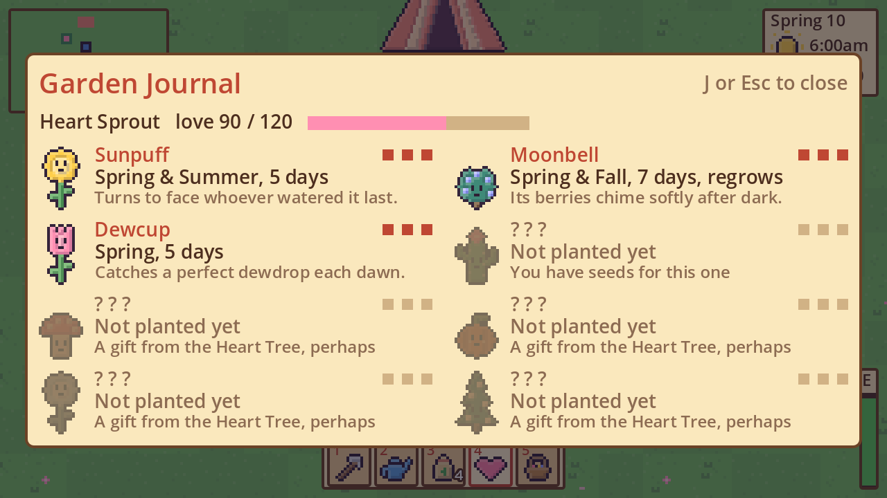

# Bloom-In-Progress
Grow a Garden Multiplayer Video Game

A cozy pixel-art co-op gardening game made with Godot 4. You can tend the
garden alone or host it for a partner to join online.





## Download and play
**[Download for Windows](https://github.com/chowmein3/Bloom-In-Progress/raw/downloads/BloomInProgress-windows.zip)**
([Linux](https://github.com/chowmein3/Bloom-In-Progress/raw/downloads/BloomInProgress-linux.zip))

1. Unzip it.
2. Double-click **BloomInProgress.exe**. The first time, Windows may say it
   doesn't recognise the app: click **More info**, then **Run anyway**.

Nothing else to install. To play together you each download it; see
[Playing together](#playing-together).

## Run it from source
1. Install [Godot 4.4 or newer](https://godotengine.org/download). Get the
   **standard** build, not the ".NET" one: the .NET build asks for a .NET SDK
   this game doesn't use.
2. Open Godot, choose **Import**, pick this folder's `project.godot`, then press **F5**.

Or from a terminal in this folder (the first command is only needed once after
downloading, and again whenever art or audio files change):

```bash
godot --headless --path . --import
```

```bash
godot --path .
```

## Controls
| Key | Action |
|---|---|
| WASD / arrows | Move |
| Space / E | Use the current tool on the highlighted tile |
| 1-5 | Hoe, Watering Can, Seeds, Hands (pet), Basket (harvest) |
| Tab | Next tool |
| Q | Next seed type |
| J | Garden journal |
| M | Show or hide the minimap |
| N | Music on/off |
| H | Show or hide the help card |
| Esc | Pause menu (resume, return to title, exit) |

Face the tent and press Space to sleep. Plants grow overnight if they were
watered, and the game saves each night.

## Title menu
- **New:** name a garden and start it. Each garden has its own save file.
- **Load:** pick a saved garden, or delete one.
- **Co-op:** host one of your gardens for a partner, or join theirs.
- **Exit:** quit.

Gardens are saved each night when you sleep, so returning to the title or
quitting mid-day loses that day's progress.

## What to do
- Water plants every day; pet them (tool 4) to raise their mood. A happy plant
  in bloom turns radiant and gives extra seeds.
- Care for the **Heart Tree** by the tent: water and hug it daily. It also
  grows from all the care the rest of the garden gets, and drops seeds for new
  kinds of plants each time it reaches a new stage.
- The **journal** (J) fills in as you plant, bloom and make radiant each of
  the eight kinds of plant.
- Plants sleep through seasons they don't like; they don't die.

## Playing together
One of you hosts; the garden and its save file live on the host's computer.
You each need the game.

### Through the relay (no router settings, no addresses)
1. **Host:** title menu > **Co-op > Host** > pick a garden. The game shows the
   garden's invite code (like `ABC-DEF`) and copies it; send it to your partner.
2. **Partner, first time:** **Co-op > Join**, paste the code, press Join.
3. **Every time after:** the partner's Join screen lists the garden and lights
   it up whenever the host has it open. One click.

The game is set up to use the relay at
`https://bloom-in-progress-relay.onrender.com`. The first connection of the
day can take up to a minute while the relay wakes. See
[Setting up the relay](#setting-up-the-relay) to run your own.

### Without the relay (`relay_url=""` in `project.godot`)
- **Same Wi-Fi:** the host's garden appears on the partner's Join screen by
  itself; click it. If Windows asks about the firewall, click **Allow access**.
- **Different homes:** the host's game asks their router to let the partner in
  (UPnP). When that works, the host's help card (H) shows an "Elsewhere:"
  address for the partner to type. Otherwise the host forwards **UDP port
  24565** on their router.

In both cases the day ends when you are both in the tent, and petting the same
plant on the same day gives it a duet mood bonus.

## Setting up the relay
The relay is a tiny server (`relay/server.js`) that both games connect out to,
so neither player opens a router port. It only passes messages between the two
of you and stores nothing. Deploying it on Render's free plan takes a few minutes:

1. Open <https://render.com/deploy?repo=https://github.com/chowmein3/Bloom-In-Progress>
   and sign in with GitHub.
2. Accept the suggested service (`bloom-in-progress-relay`, free plan) and
   press **Deploy**. Wait until it says **Live**.
3. Copy the service's address from the top of its page. It looks like
   `https://bloom-in-progress-relay.onrender.com`. Opening it in a browser
   should show "Bloom In Progress relay is running".
4. Put that address in `project.godot`, in the `[bloom]` section:
   `relay_url="https://bloom-in-progress-relay.onrender.com"`, then rebuild
   the download (or run from source). Both players need a build with it.

   To try it without rebuilding, put a text file named `override.cfg` next to
   `BloomInProgress.exe` on both computers, containing:

   ```
   [bloom]
   relay_url="https://bloom-in-progress-relay.onrender.com"
   ```

A free Render service goes to sleep after 15 minutes without visitors, so the
first connection of the day can take up to a minute while it wakes. The game
starts waking it as soon as it launches.

To try co-op on one computer, start two copies and join `127.0.0.1`:

```bash
godot --path . -- --host
```

```bash
godot --path . -- --join=127.0.0.1
```

## Building the download yourself
With Godot's export templates installed (Editor > Manage Export Templates):

```bash
tools/build.sh godot
```

This writes `export/BloomInProgress-windows.zip` and the Linux one.
`tools/publish_downloads.sh` then puts them on the `downloads` branch, which is
where the links above point. `.github/workflows/release.yml` does both on every
push to `main` when GitHub Actions is available for the account.

## Art and audio
The sprites and sounds are generated by two scripts, so there is nothing to
license:

```bash
python3 tools/make_art.py
```

```bash
python3 tools/make_audio.py
```

To use hand-drawn art or your own music, replace any file in `assets/` with one
of the same name, size and frame layout (described at the top of each section
of the scripts) and stop running the script for that file.

## Tests
Garden rules:

```bash
godot --headless --path . res://tests/test_runner.tscn
```

Menus (title, new, load, host, join, pause):

```bash
godot --headless --path . res://tests/menu_test.tscn
```

Co-op (starts a host and a guest on this machine; needs bash):

```bash
tests/run_coop_test.sh godot
```

See `docs/DESIGN.md` for the rules and roadmap.
